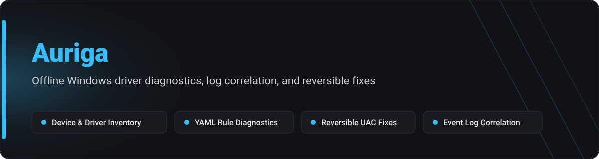
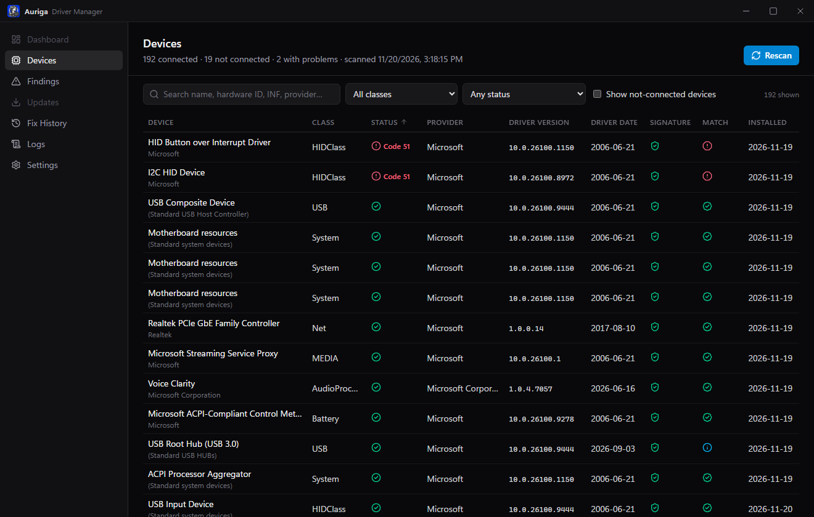
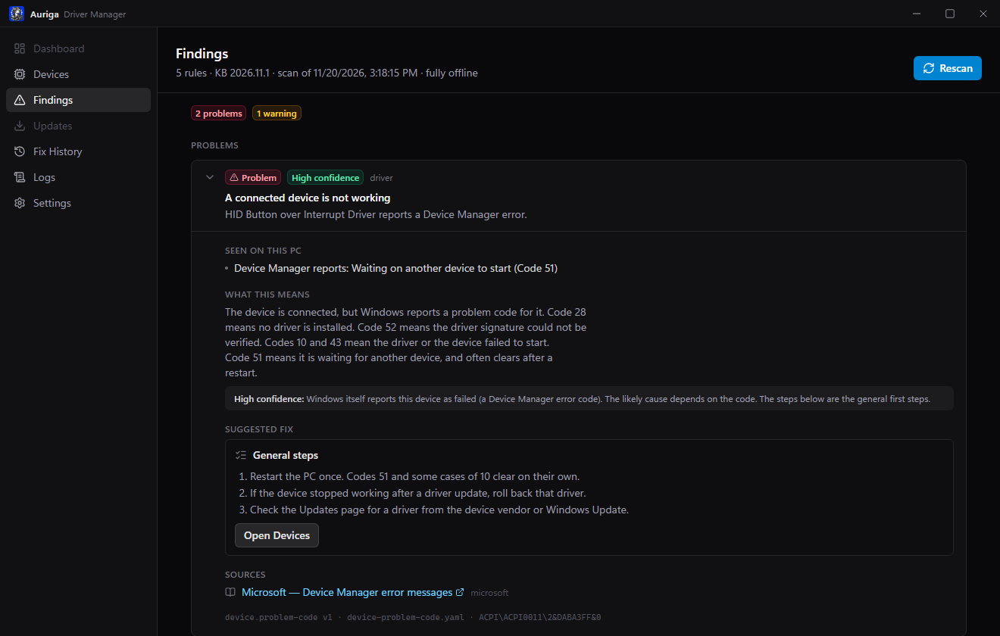
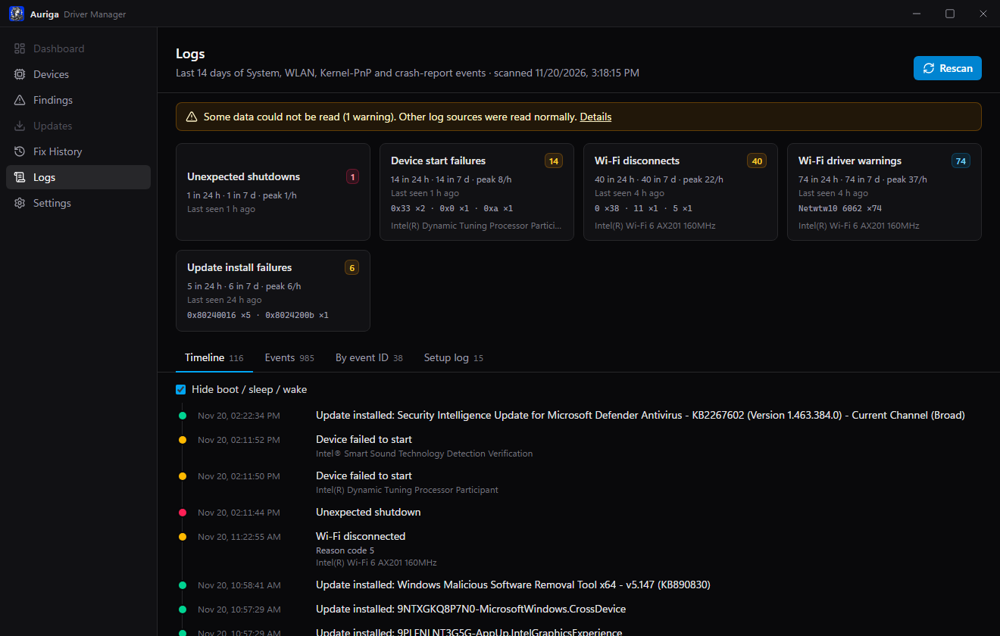
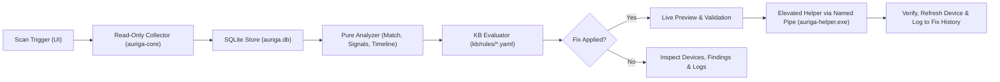

<div align="center">


# Auriga

Offline Windows driver diagnostics, event-log correlation, and reversible UAC-gated fixes.


<br /><br />



<br /><br />

[Features](#features) • [Screenshots](#screenshots) • [How it works](#how-it-works) • [Installation](#installation) • [Usage](#usage) • [Configuration](#configuration) • [Troubleshooting](#troubleshooting)

</div>

## About

Auriga is a Windows desktop application built with Tauri 2, Rust (`auriga-core`, `auriga-helper`, `helper-ipc`), and React 19. The main UI runs as a standard user and collects read-only snapshots of installed devices, drivers, 14-day Windows Event Logs, `setupapi.dev.log`, and crash dump metadata into a local SQLite database (`auriga.db`). Diagnostics run offline against a hot-reloaded YAML knowledge base with no telemetry, while privileged write actions and minidump header reads are isolated in a separate on-demand UAC helper (`auriga-helper.exe`) that accepts only typed IPC operations and exits after 2 minutes idle.

## Features

- **Device & driver inventory** — Lists connected and disconnected PnP devices with class, status/problem codes, driver provider, version, date, Authenticode signature status, driver match quality, and install date, with filtering and a detail drawer.
- **Offline YAML rule diagnostics** — Evaluates snapshots against schema-validated YAML rules (`kb/rules/*.yaml`) with severity, confidence levels, concrete evidence extracted from the PC, and vendor/Microsoft source links. Edits to rule files hot-reload without restarting.
- **Event log & setup log correlation** — Reads the last 14 days of System, WLAN, Kernel-PnP, and crash-report events plus `setupapi.dev.log`, attributes events to devices by instance ID, `InterfaceGuid`, or unique service name, groups by event ID, classifies named signals, and builds a collapsed timeline.
- **Opt-in minidump header inspection** — Lists crash dumps on disk and optionally reads bugcheck codes and parameters from minidump headers via the elevated helper without modifying files.
- **Previewed, reversible fixes** — Re-reads live device state before applying adapter advanced property changes, `PnPCapabilities` power management toggles, or driver rollbacks; supports optional System Restore point creation, verifies the post-write value, records prior raw values in SQLite, tracks before/after signal rates, and provides one-click revert.
- **Least-privilege architecture** — The main app never runs elevated. Only typed operations (`SetAdapterProperty`, `SetPnpCapabilities`, `RestartDevice`, `CreateRestorePoint`, `RollbackDriver`, `ListMinidumps`, `Ping`, `Shutdown`) cross the named-pipe boundary to `auriga-helper.exe`, which re-validates every write target before touching the system.

## Screenshots

<p align="center">
  
  <br />
  <em>Devices view showing connected hardware, Device Manager problem codes, driver versions, signature status, and match assessments.</em>
</p>

<p align="center">
  
  <br />
  <em>Findings view matching offline knowledge-base rules against the latest scan with evidence, explanations, and suggested actions.</em>
</p>

<p align="center">
  
  <br />
  <em>Logs view displaying classified signal cards and a device-attributed timeline across Windows Event Logs and setupapi.dev.log.</em>
</p>

## How it works



## Installation

### Prerequisites

- **Windows 10 / 11** (Windows-only; relies on Win32 PnP, Event Log, Registry, and UAC APIs)
- **Rust toolchain** supporting Edition 2024 (`cargo`, `rustc`) with the MSVC target
- **Node.js** and `npm`
- **WebView2 Runtime** (pre-installed on Windows 11 and current Windows 10 builds)

### Build from source

```bash
git clone https://github.com/projectGloria/Auriga.git
cd Auriga
npm install
```

Run in development mode (builds `auriga-helper.exe`, starts Vite on port `1420`, and opens the Tauri window):

```bash
npm run tauri dev
```

Build a release NSIS installer (builds release `auriga-helper.exe`, type-checks and bundles the frontend, and packages the Tauri app with `kb/` resources):

```bash
npm run tauri build
```

## Usage

1. **Devices** — Click **Rescan** to collect a snapshot of connected and disconnected devices. Search by name, hardware ID, INF, or provider, filter by class or status (problem codes, disabled, invalid signature, or match warnings), and click a row to inspect full device details.
2. **Findings** — Review problems, warnings, and notes matched by the offline knowledge base. Expand a finding to see observed evidence, vendor/Microsoft references, and ordered fixes. Click **Preview & apply…** on applicable fixes to inspect exact before/after registry values and optionally create a System Restore point before confirming via UAC.
3. **Fix History** — Inspect every applied fix with its prior and new raw values, post-fix signal rate comparison after subsequent scans, and a **Revert…** action to restore the exact previous value.
4. **Logs** — Inspect signal summary cards (unexpected shutdowns, device start failures, Wi-Fi disconnects, Wi-Fi driver warnings, update install failures, display TDRs), browse the collapsed **Timeline**, filter raw **Events**, inspect counts **By event ID**, check **Setup log** (`setupapi.dev.log`), or click **Read minidumps (admin)** to inspect bugcheck headers.
5. **Settings** — Run **Test helper connection (UAC)** to verify the elevated helper IPC round-trip without modifying any system settings.

### Development commands

```bash
npm run dev          # Frontend-only browser preview using public/dev-latest.json and public/dev-findings.json
npm run typecheck    # Run TypeScript type checking (tsc --noEmit)
npm run bindings     # Regenerate TypeScript bindings in src/bindings/ from Rust via ts-rs
cargo test --workspace
```

## Configuration

| Setting / Path | Purpose |
| --- | --- |
| `AURIGA_KB_DIR` | Optional environment variable pointing to a custom knowledge base directory containing `rules/*.yaml`. If unset, Auriga uses the bundled `kb/` resource (or the repository's `kb/` folder in debug builds). |
| `kb/manifest.yaml` | Declares `kb_version` and `schema_version` for the active knowledge base. |
| `kb/rules/*.yaml` | Diagnostic rule files validated against `kb/schema/rule.schema.json`. Invalid rule files are skipped and surfaced as a warning banner while valid rules continue to load; edits hot-reload automatically. |
| `%APPDATA%\com.auriga.drivermanager\auriga.db` | Local SQLite database storing scan snapshots and fix history. If unavailable, Auriga falls back to an in-memory database and displays a warning. |

## Troubleshooting

- **"History database unavailable" warning** — Auriga could not open or create `auriga.db` in the Tauri app data directory and fell back to an in-memory database. Check folder permissions under `%APPDATA%\com.auriga.drivermanager\`.
- **Rule file skipped warning on Findings** — One or more YAML files in the active KB directory failed validation against `kb/schema/rule.schema.json`. The warning banner lists the exact filename and validation error; fix the YAML file and save to trigger hot reload.
- **UAC helper fails to start or test fails** — Ensure `auriga-helper.exe` is built alongside `auriga.exe` (`npm run dev:app` / `npm run build:app`) and that the UAC prompt is approved. Use **Settings → Test helper connection (UAC)** to verify PID, elevation state, and IPC round-trip time.
- **"Not running inside Tauri" message in browser** — Running `npm run dev` outside Tauri only loads static preview fixtures (`public/dev-latest.json` and `public/dev-findings.json`); live scanning and fixes require running the desktop app via `npm run tauri dev`.
- **Some log sources report warnings** — Read-only collection runs without admin rights, so restricted sources (such as `C:\Windows\Minidump`) report a warning instead of failing the scan. Use **Logs → Read minidumps (admin)** when you explicitly want to inspect minidump headers.
